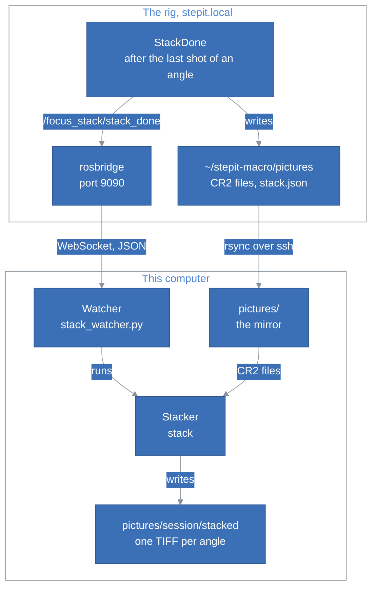
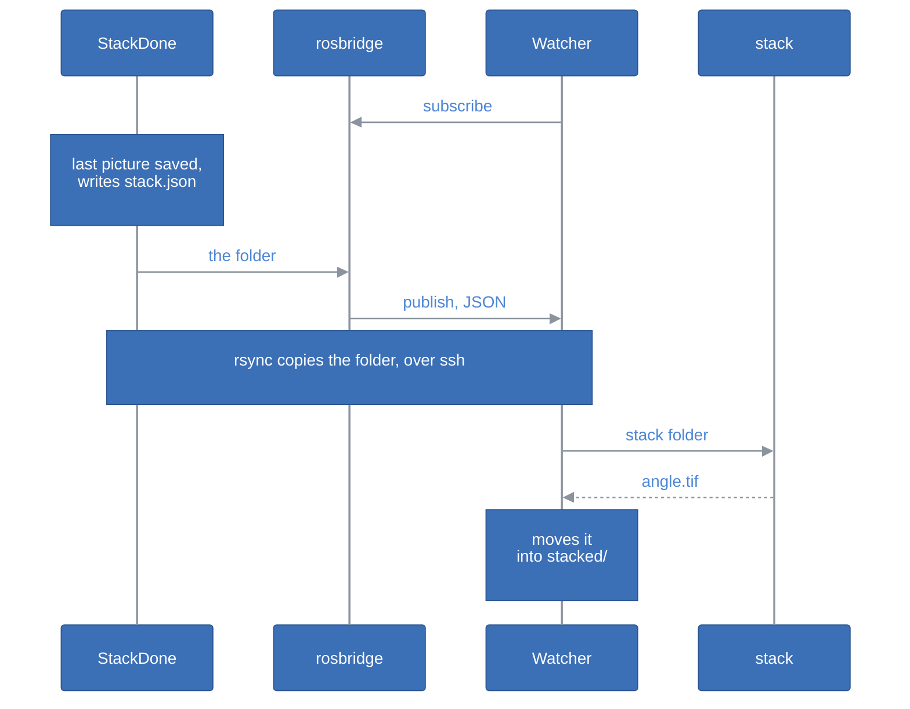

# StepIt Stacker Architecture

## Table of Contents <!-- omit in toc -->

- [Introduction](#introduction)
- [The Big Picture](#the-big-picture)
- [The Parts](#the-parts)
- [The Stacker](#the-stacker)
  - [One Frame, From Raw to Merge](#one-frame-from-raw-to-merge)
  - [Every Frame of a Stack Is Developed the Same Way](#every-frame-of-a-stack-is-developed-the-same-way)
  - [Hot and Dead Pixels](#hot-and-dead-pixels)
  - [The Camera's Tones](#the-cameras-tones)
  - [The Orientation](#the-orientation)
  - [Alignment and Merging](#alignment-and-merging)
- [The Watcher](#the-watcher)
  - [Following the Rig](#following-the-rig)
  - [Catching Up](#catching-up)
  - [Merging a Stack](#merging-a-stack)
- [The Containers](#the-containers)
- [Tests](#tests)
- [How to Extend StepIt Stacker](#how-to-extend-stepit-stacker)
- [Design Decisions and Trade-offs](#design-decisions-and-trade-offs)

## Introduction

This document explains how StepIt Stacker is built, what each part is responsible for, and where to start when we want to change something. It assumes we have read the [README](../README.md) and merged a stack once.

This document covers the stacker and its watcher. The 3D pipeline, a prototype that develops with darktable, merges in 16 bits and shows the result on the Looking Glass Portrait, is described in [`pipeline/README.md`](../pipeline/README.md).

It follows one idea: **the rig only shoots, and says when a stack is complete; everything else happens on this computer**. The rig, [StepIt Macro](https://github.com/kineticsystem/stepit-macro), knows nothing about StepIt Stacker: it publishes a fact about its own pictures, and StepIt Stacker reads it, copies the pictures and develops them here.

## The Big Picture

StepIt Stacker has two parts: the **stacker**, a C++ command that merges a folder of raw frames into one image, and the **watcher**, a Python service that follows the rig and runs the stacker on each stack as soon as the rig has shot it.

What StepIt Stacker uses of the rig:

| Name | Type | What it is |
|---|---|---|
| `/focus_stack/stack_done` | `std_msgs/String` topic, latched | The folder of an angle whose pictures are all saved, relative to the rig's pictures folder, e.g. `2026-10-07_12-29-19/angle_01_0.0deg`. Published by `StackDone` in the objective `FocusStack`. |
| `ws://stepit.local:9090` | rosbridge WebSocket | The commander's rosbridge, which StepIt UI also uses. It relays the topic as JSON. |
| `stack.json` | file in the folder of a finished angle | The shots, the angle and the files of the folder. Written to a temporary file and renamed, so its presence says the stack is complete. |
| `robot@stepit.local:stepit-macro/pictures` | ssh and rsync | The rig's pictures folder, which the watcher reads and never writes. |

## The Parts

| Path | Role |
|---|---|
| [`src/main.cc`](../src/main.cc) | The command `stack`: its options, finding the stacks of a folder, and merging each one with focus-stack. |
| [`src/raw_loader.cc`](../src/raw_loader.cc) | Decoding a raw file with LibRaw into an 8-bit image: the defect repair, the brightness, the camera's tone curve. |
| [`src/defect_pixels.cc`](../src/defect_pixels.cc) | Finding and repairing the hot and dead pixels in the raw data. |
| [`watcher/stack_watcher.py`](../watcher/stack_watcher.py) | The watcher: following the rig, catching up, copying and merging each stack. |
| [`bin/stack.sh`](../bin/stack.sh) | Runs the stacker on a folder from the host, in a throwaway container. |
| [`bin/watcher.sh`](../bin/watcher.sh) | Starts and stops the watcher's container. |
| [`bin/build.sh`](../bin/build.sh) | Builds the stacker into `build`, in the container. |
| [`docker/`](../docker) | The image, which builds the stacker and runs both parts, and the development container. |

[focus-stack](https://github.com/PetteriAimonen/focus-stack) is not copied into the repo: [`CMakeLists.txt`](../CMakeLists.txt) fetches it at a fixed commit and builds its library, without its own command line tool. Its `CMakeLists.txt` works only as a top-level project, so our build lists its sources instead of adding it as a subdirectory.

## The Stacker

`stack <folder>` finds every folder below `<folder>` that holds raw files, `<folder>` itself included, and merges each one into an image named after its path, in `<folder>/stacked` or the folder given with `-o`. Each stack is merged on its own, one after the other.

### One Frame, From Raw to Merge

Each frame goes through the same steps, in [`loadRaw()`](../src/raw_loader.cc), then into focus-stack:

1. LibRaw opens the file and unpacks the raw sensor data, before demosaicing.
2. `repairDefectPixels()` repairs the hot and dead pixels in that data.
3. LibRaw demosaics it into sRGB, with the camera's white balance, and the brightness of the stack.
4. LibRaw makes an 8-bit image of it, and the tone curve of the stack gives it the camera's tones.
5. `FocusStack::add_image()` hands it to focus-stack, which aligns it to its neighbour and adds it to the merge.

The frames are decoded on the main thread while focus-stack's workers align and merge the previous ones, so decoding costs little time: a stack of 12 frames takes about 36 seconds.

### Every Frame of a Stack Is Developed the Same Way

**The brightness and the tone curve are computed on the first frame of a stack, and applied to every frame of it.** The merge keeps, at each point, the frame that is sharpest there, so it switches between frames across the image: two frames developed differently would leave visible bands where it switches. LibRaw's automatic brightness, which depends on the content of each frame, would do exactly that.

`mergeStack()` in [`main.cc`](../src/main.cc) owns this: it copies the options of the stack, and after the first frame it fills in the brightness and the tone curve that `loadRaw()` returned. Each stack gets its own: the angles of a session can be exposed differently. This is the detail that is easy to break: computing anything per frame in `loadRaw()` must go through the same mechanism.

### Hot and Dead Pixels

[`defect_pixels.cc`](../src/defect_pixels.cc) works on the raw Bayer data, before demosaicing and before alignment. A defect sits at the same place on the sensor, but alignment moves each frame differently, so a defect left in place lands at a different spot in each frame, and the merge, which favours sharp contrasted points, keeps them all, as a trail of coloured dots.

A pixel is a defect when two things are true:

- It is much brighter or darker than all 8 nearest pixels of its colour, 2 pixels away in the Bayer pattern. The margin is the largest of `--min-jump` (256 raw units), the spread of the 8 neighbours, and 1/8 of the brightest neighbour's signal above black: photon noise grows with the signal, and so must the margin.
- The 4 pixels touching it, of the other colours, are not raised with it by more than a quarter of its excess. Light passes through the lens, which spreads even a tiny glint onto them; a defect stands alone.

The second test exists because of macro work: the matte top of a chip sparkles at the scale of a single pixel. The thresholds were measured on the rig's 5D Mark II at ISO 800: each frame gets 100 to 250 repairs, of which about 160 positions repeat across frames of different subjects, i.e. true defects. A change to the thresholds needs the same check, see [Tests](#tests).

A defect is replaced with the median of its 8 neighbours of the same colour. The detection reads an untouched copy of the data, so a repair never influences the next pixel's test.

### The Camera's Tones

A plain sRGB rendering of the raw data is darker and flatter than the shots as we see them on screen: viewers show the JPEG the camera embeds in every CR2, which has Canon's tone curve, its Picture Style. `fitCameraTone()` in [`raw_loader.cc`](../src/raw_loader.cc) reproduces it.

On the first frame of a stack, it decodes the embedded JPEG, turns it upright, and compares it with our rendering at 1/16 of the size, where the few pixels the camera crops differently become less than one. For each colour, the median level of the JPEG at each level of our rendering is a point of the curve; the levels in between are joined by straight lines, from black to white, and the curve never goes down, so that noise cannot invert it. The result is a lookup table for `cv::LUT()`.

The orientation is the detail that is easy to break. The JPEG is stored as the sensor sees it. It is turned exactly as our rendering was, by `--rotate`, and decoded with `IMREAD_IGNORE_ORIENTATION`: OpenCV would otherwise turn it by its own EXIF orientation too, and the curve would compare two images that do not match. When the shapes still do not match, or the file has no JPEG, the stack keeps a plain sRGB rendering, and the command says so.

### The Orientation

**The orientation the camera records is ignored.** Every frame is decoded as the sensor sees it, landscape, then turned by `--rotate`, 0 by default, the same for every frame of every stack. The 5D Mark II decides the orientation with a tilt sensor, which cannot tell which way is up when the camera points down at the subject, as it does on the rig. It records different orientations for the frames of one stack: on one session of the rig, an angle had 6 frames flagged landscape and 6 flagged portrait, either way, even with Auto rotate off in the camera's menu. Frames turned by their own flags are partly landscape and partly portrait, which focus-stack cannot align: its alignment then reads outside the image, and the process crashes.

`flipOf()` in [`raw_loader.cc`](../src/raw_loader.cc) turns `--rotate` into LibRaw's `user_flip`, which overrides the file's flag; `fitCameraTone()` takes the same code.

### Alignment and Merging

focus-stack aligns each frame to its neighbour, with an affine transform, and corrects the brightness and the white balance between them. The rig repeats its positions exactly, yet the frames need it: on a linear rail the camera moves toward the subject, so each frame is magnified more than the one before, 0.3% to 1.5% per step on the sessions measured. Without alignment, every edge appears several times in the image.

Then focus-stack merges the frames with a wavelet transform, keeping the sharpest detail at each point, and crops the image to the area every frame covers.

> [!WARNING]
> When focus-stack's alignment fails on a frame, the process crashes with a segmentation fault instead of reporting an error. The stack gets no image; the watcher logs the failure and goes on with the next stack. The stacks that failed this way on the rig had frames of different orientations, before the camera's orientation was ignored; frames with little texture, e.g. a subject at the edge of the frame on a plain background, may still make it fail.

focus-stack works in 8 bits per channel only, so the images are 8-bit TIFF.

## The Watcher

[`stack_watcher.py`](../watcher/stack_watcher.py) is one class, `Watcher`, with three threads: the WebSocket's, which receives the announcements; a catch-up thread at each connection; and the worker, which merges one stack at a time from a queue.

### Following the Rig

`StackDone` runs on the rig, rosbridge is the commander's, on port 9090, and `rsync` copies the folder over ssh. The watcher opens the WebSocket and sends one `subscribe` for `/focus_stack/stack_done`; rosbridge then pushes every message of the topic as it is published, about 0.2 seconds after `StackDone` runs. The rig never needs the address of this computer: to it, the watcher is one more subscriber, as the pages of StepIt UI are.

It pings every 20 seconds, which finds within about 30 seconds a rig that went away without closing the connection, e.g. switched off, and connects again every 10 seconds.

A folder name from the rig must match `[A-Za-z0-9_+.-]` and `/`, without `..`, before it reaches a command: rsync and ssh pass it to the shell of the rig.

### Catching Up

A message published while the watcher is not connected is lost: the topic is a live push, not a queue. So at every connection, the watcher asks the rig over ssh for every `stack.json`, and queues each stack that has no image here yet, or an image older than its `stack.json`, which a stack shot again into the same folder would renew. That is what makes `stack.json` necessary: without it, the files could not tell a finished stack from one in progress.

A stack can be queued twice, by the catch-up and by the latched topic, which rosbridge may send again when the watcher subscribes. The queue ignores a stack already in it, and a stack already merged is skipped.

### Merging a Stack

For each stack, the worker:

1. Copies the folder with `rsync -a --partial` into the mirror, `pictures/<session>/<angle>`, and checks that every file `stack.json` lists has arrived.
2. Runs `stack` on it, into a hidden temporary folder, `stacked/.<angle>.tmp`.
3. Moves the image into `stacked/<angle>.tif` once it is whole, and removes the temporary folder.

A merge cut short, by a crash or a stop of the container, leaves no image behind, so the next catch-up merges the stack again. One stack that fails is logged with its error, and the worker goes on with the next.

## The Containers

One image, `stepit-stacker`, built from [`docker/Dockerfile`](../docker/Dockerfile) on Ubuntu 24.04, holds the build tools, OpenCV, LibRaw, and the watcher's tools: Python with `python3-websocket`, rsync, ssh and `libnss-mdns`. It runs in three ways:

| Container | Started by | What it mounts |
|---|---|---|
| `stepit-stacker`, for development | `./docker/dock.sh stepit-stacker start` | The repo at `~/ws`, the home at its own path. |
| A throwaway one per run | `./bin/stack.sh` | The repo at `~/ws`, the home at its own path, and the folders given outside it. |
| `stepit-stacker-watcher` | `./bin/watcher.sh start` | The repo at `~/ws`, the home at its own path, `~/.ssh` read-only, and the host's Avahi socket. |

The repo is always at `~/ws`, so the CMake cache in `build`, which records its path, is valid in all three; the stacker is built once and run by all of them. The home is mounted at its own path, so that a folder is given to the stacker by its host path.

Docker containers cannot resolve `.local` names, e.g. `stepit.local`: the watcher's container resolves them through the host's Avahi daemon, with `libnss-mdns` and the daemon's socket, `/run/avahi-daemon/socket`. The container restarts with the computer, until `./bin/watcher.sh stop`.

## Tests

StepIt Stacker has no automated tests yet. It was checked by hand, on sessions of the rig, and these are the checks to repeat after a change to each part:

| Part | How to check it |
|---|---|
| Defect repair | Count the repairs per frame and the positions that repeat across frames of different subjects: 100 to 250 per frame at ISO 800, about 160 repeating. Compare 100% crops of a dark area merged with and without `--no-defect-repair`: the coloured dots must go, the texture must stay. |
| Camera tones | Compare the median and the 95th percentile of the merged image with the camera's JPEG of a frame: within about 5 levels. |
| Alignment | Run with `--verbose`: the magnification of each frame, in the `transform` lines, must shrink steadily. Look at a 100% crop of an edge for doubled lines. |
| The watcher | Start it, shoot a FocusStack, follow `./bin/watcher.sh logs`: each angle is queued as `announced by the rig`, copied and merged. Stop it during a stack and start it again: the missing angles are queued as `catching up`. |

The stack of the rig, `StackDone` and its `stack.json`, is tested in StepIt Macro, against its fake camera.

## How to Extend StepIt Stacker

**Turn every image another way.** `./bin/watcher.sh start -- --rotate 90` turns the images of every stack the watcher merges. Never let a frame keep the camera's orientation: see [The Orientation](#the-orientation).

**Add an option of the stacker.** Add it to `Options` and `parseArguments()` in [`main.cc`](../src/main.cc), and to the help; if it concerns decoding, to `RawOptions` in [`raw_loader.hh`](../src/raw_loader.hh). Document it in the README's table of parameters. Options given after `--` to `./bin/watcher.sh start` reach every merge of the watcher.

**Compute something per stack, e.g. a white balance.** Compute it in `loadRaw()` when the option is empty, return it in `RawImage`, and let `mergeStack()` set it in the stack's options after the first frame, as the brightness and the tone curve are. Never compute it per frame.

**Do more with each finished stack, e.g. a depth map or a 3D model.** Add it to `Watcher.merge()`, after the image is in place, or as a new step of the queue. The watcher already knows the stack is complete and copied.

**Follow another rig, or another folder of the rig.** `STACK_RIG` and `STACK_MIRROR` set the rig and the mirror of `./bin/watcher.sh`; the watcher's own options, e.g. `--remote-pictures` and `--user`, set where the pictures are on the rig and who logs in.

## Design Decisions and Trade-offs

**focus-stack, not enfuse or Zerene Stacker.** focus-stack is MIT, C++, and works on images in memory, which LibRaw gives it. enfuse and `align_image_stack` of Hugin are GPL, which an MIT project cannot link; Zerene Stacker is proprietary. The price is focus-stack's 8-bit merge, and an alignment that can fail on frames with little texture.

**LibRaw in the process, not a raw converter on the command line.** The defect repair has to work on the raw data, between unpacking and demosaicing, which only a library gives access to. LibRaw is LGPL or CDDL, and is linked dynamically.

**The defect repair finds the defects in each frame, with no calibration file.** A map of the sensor's defects, made once from dark frames, would be exact, but it ages with the sensor and needs a calibration step. The repair finds them in each frame, as Adobe's converters do, at the price of thresholds that were measured on this camera.

**The camera's tone curve, fitted to its own JPEG.** A fixed curve would match one Picture Style of one camera. Fitting the embedded JPEG matches whatever the camera was set to, at the price of depending on that JPEG, which every Canon raw file carries.

**The rig announces the stacks; the watcher does not watch the files.** A folder that stops growing may only be waiting for its next shot, and its last file may still be being written. Only the rig knows when an angle is complete, so it says it, as a ROS topic and as `stack.json`. The rig does not know who listens.

**rosbridge, not ROS on this computer.** The rig's DDS is set to its own computer, loopback only. Opening it to the network would change the whole rig, and need ROS here. rosbridge is already there for StepIt UI, and a WebSocket client is a few lines of Python.

**rsync over ssh, not the camera's web server.** StepIt Camera serves the pictures over HTTP, on port 8090, but rsync resumes a copy cut short, copies a folder in one command, and skips the files already here. ssh also lists the `stack.json` files for the catch-up. The price is a key that logs in to the rig.

**Python for the watcher, C++ for the stacker.** The watcher is glue: a WebSocket, a queue, rsync and a subprocess. The stacker is where the time goes, and is C++ to work with LibRaw and focus-stack directly.

**One stack at a time.** A merge uses every core and about 3.5 GB of memory, so merging two at once would be no faster. The rig takes longer to shoot an angle than this computer to merge it, so the queue stays short.

**The images stay on this computer.** The rig is a source of pictures, and nothing goes back to it: the mirror and the images live in this repo's `pictures` folder, which git ignores.
