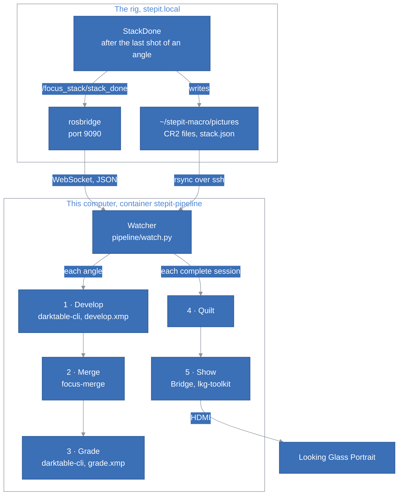
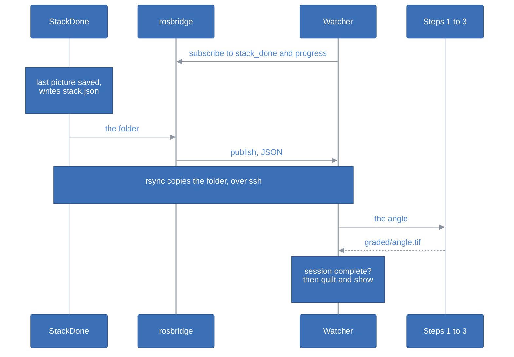

# StepIt Stacker Architecture

## Table of Contents <!-- omit in toc -->

- [Introduction](#introduction)
- [The Big Picture](#the-big-picture)
- [The Parts](#the-parts)
- [The Pipeline](#the-pipeline)
  - [1. Develop](#1-develop)
  - [2. Merge](#2-merge)
  - [3. Grade](#3-grade)
  - [4. Quilt](#4-quilt)
  - [5. Show](#5-show)
- [The Watcher](#the-watcher)
  - [Following the Rig](#following-the-rig)
  - [Catching Up](#catching-up)
  - [A Complete Session](#a-complete-session)
- [The Containers](#the-containers)
- [Tests](#tests)
- [How to Extend StepIt Stacker](#how-to-extend-stepit-stacker)
- [Design Decisions and Trade-offs](#design-decisions-and-trade-offs)

## Introduction

This document explains how StepIt Stacker is built, what each part is responsible for, and where to start when we want to change something. It assumes we have read the [README](../README.md).

It follows one idea: **the rig only shoots, and says when an angle is complete; everything else happens on this computer**. The rig, [StepIt Macro](https://github.com/kineticsystem/stepit-macro), knows nothing about StepIt Stacker: it publishes facts about its own pictures, and StepIt Stacker reads them, copies the pictures and processes them here.

## The Big Picture

StepIt Stacker is a Python package, `pipeline`, that chains other programs: darktable for the development and the grading, `focus-merge`, our C++ program, for the merge, and Looking Glass's software for the display. It runs in one container, `stepit-pipeline`, which follows the rig.

What StepIt Stacker uses of the rig:

| Name | Type | What it is |
|---|---|---|
| `/focus_stack/stack_done` | `std_msgs/String` topic, latched | The folder of an angle whose pictures are all saved, relative to the rig's pictures folder, e.g. `2026-10-07_12-29-19/angle_01_0.0deg`. Published by `StackDone` in the objective `FocusStack`. |
| `/focus_stack/progress` | `std_msgs/Int32MultiArray` topic, latched | `[pictures taken, pictures in total]` of the whole FocusStack. Equal when the session is complete. |
| `ws://stepit.local:9090` | rosbridge WebSocket | The commander's rosbridge, which StepIt UI also uses. It relays the topics as JSON. |
| `stack.json` | file in the folder of a finished angle | The shots, the angle and the files of the folder. Written to a temporary file and renamed, so its presence says the angle is complete. |
| `robot@stepit.local:stepit-macro/pictures` | ssh and rsync | The rig's pictures folder, which StepIt Stacker reads and never writes. |

## The Parts

| Path | Role |
|---|---|
| [`bin/pipeline.sh`](../bin/pipeline.sh) | Builds and starts the container `stepit-pipeline`, with the screen, the GPU and the USB of the Looking Glass, and runs the commands in it. |
| [`pipeline/__main__.py`](../pipeline/__main__.py) | The commands: `watch`, `session`, `edit`, `grade`, `quilt`, `show`. |
| [`pipeline/watch.py`](../pipeline/watch.py) | The watcher: one angle at a time, as the rig announces them, and the quilt once the session is complete. |
| [`pipeline/rig.py`](../pipeline/rig.py) | The rig: its topics through rosbridge, its pictures through ssh and rsync. |
| [`pipeline/process.py`](../pipeline/process.py) | The steps chained, for an angle and for a session. |
| [`pipeline/darktable.py`](../pipeline/darktable.py) | Steps 1 and 3, with `darktable-cli`, and darktable's window for `edit`. |
| [`pipeline/merge.py`](../pipeline/merge.py) | Step 2: runs `focus-merge`. |
| [`pipeline/quilt.py`](../pipeline/quilt.py) | Step 4. |
| [`pipeline/display.py`](../pipeline/display.py) | Step 5. |
| [`pipeline/layout.py`](../pipeline/layout.py) | Where the files of a session are. |
| [`pipeline/config.py`](../pipeline/config.py) | Reads `config/pipeline.toml`. |
| [`src/`](../src) | `focus-merge`: `tiff_io` reads and writes the 16-bit TIFFs, `align` aligns the frames, `fuse` merges them, `main` chains them. |
| [`config/`](../config) | `pipeline.toml`, `develop.xmp`, `grade.xmp`. |
| [`tests/`](../tests) | `focus-merge` on a synthetic focus stack, and the quilt. |
| [`docker/`](../docker) | The image, and the development container. |

## The Pipeline

[`process.py`](../pipeline/process.py) runs steps 1 to 3 for each angle, and steps 4 and 5 for a session. Every step writes its result to a temporary name and moves it into place once whole, so a step cut short leaves no file behind, and the next run does it again.

### 1. Develop

`darktable-cli` develops every raw frame of the angle, in one run, into a 16-bit TIFF with the settings of [`config/develop.xmp`](../config/develop.xmp). The frames come out:

- **Linear.** No exposure, no tone curve, no sharpening, nothing but darktable's basic raw steps: the sensor's values, with nothing clipped. On a frame of the 5D Mark II the brightest pixel is at about a third of the 16-bit range.
- **In linear Rec.2020,** with the ICC profile embedded: a gamut wide enough that no colour is clipped before the grading.
- **With the hot pixels repaired,** by darktable's hot pixels module, on the raw data, before demosaicing, where a defect is still a single photosite.
- **With the white balance the camera recorded,** the same in every file of a session.
- **As the sensor sees them, landscape.** The camera's orientation is ignored. The 5D Mark II decides it with a tilt sensor, which cannot tell which way is up when the camera points down at the subject, as it does on the rig: on one session, an angle had 6 frames flagged landscape and 6 portrait, even with Auto rotate off. Frames turned by their own flags could not be aligned. `images.rotate` turns the merged image instead, the same way for every angle.

`develop.xmp` lists only what it changes: the hot pixels module on, the orientation off. darktable fills in its basic steps for each file, e.g. the white balance of that file. Three settings given on the command line complete it: 16-bit TIFF, the white balance the camera recorded ("legacy" chromatic adaptation), and no default exposure and tone curve (workflow "none").

**Every run gets a fresh darktable configuration**, a temporary folder, so the settings of the darktable used by hand never change what the pipeline does. An XMP file for `darktable-cli` must not hold comments: darktable cannot open it then.

The developed frames, about 100 MB each, are in a hidden temporary folder of the session, deleted once merged.

### 2. Merge

`focus-merge -o merged.tif frame1.tif ... --rotate <degrees>` merges the developed frames of an angle into one 16-bit TIFF, with the ICC profile of the frames. It reads the frames twice, to keep the memory low: once at half size to align them, once at full size to merge them.

**Alignment**, [`align.cc`](../src/align.cc). The rig repeats its positions exactly, yet the frames need aligning: on a linear rail the camera moves toward the subject, so each frame is magnified more than the one before, 0.3% to 1.5% per step on the sessions measured, and the light on the subject drops by 2 to 3% per step.

1. Each frame is matched to the one before with an affine transform, by OpenCV's ECC on the square root of its luminance, at half size, refined from a coarse size of at least 128 pixels to the full half size. The match of the previous pair is the starting guess.
2. The transforms are chained, so every frame is placed relative to the first.
3. The reference is the most magnified frame. It sees the smallest area, which every other frame covers, so the merged image has no empty borders. Every angle makes the same rail steps, so every angle gets the same size and framing.
4. Each frame gets a gain that brings its mean brightness to the reference's. Blur does not change the mean, so frames focused at different depths compare fairly.

A pair that cannot be matched stops the merge with `frame N cannot be aligned with frame N-1`, and the angle gets no image.

**Fusion**, [`fuse.cc`](../src/fuse.cc). Each frame, warped onto the reference, is split into a Laplacian pyramid: its detail at a series of scales, from the finest to the coarsest, and a small blurred residual. At each scale and each point, the merged pyramid keeps the detail of the frame that has the most there, measured on the luminance of the detail, made positive and smoothed over 5 × 5 pixels so that one noisy pixel does not decide alone. The residuals, the overall brightness, are averaged. Rebuilding the image from the merged pyramid blends the frames without visible seams. Everything is in floating point, so the 16 bits of the frames are kept. Frames are added one at a time, so the memory is that of two pyramids whatever the number of frames.

5 full-size frames of the 5D Mark II take about 17 seconds.

### 3. Grade

`darktable-cli` grades the merged image with the session's `grade.xmp`, or `config/grade.xmp` when the session has none, into a 16-bit TIFF in sRGB: the image of the sequence. darktable never overwrites a file, so it exports into a temporary folder, and the result replaces the graded image.

`./bin/pipeline.sh edit` makes a session's `grade.xmp` with darktable's window: it copies the current grading next to the merged image of the angle closest to 0°, as `<image>.xmp`, the sidecar darktable reads an image's edit from, and opens darktable on it, with a library in memory, so that darktable always reads the sidecar. darktable saves every change there. Once darktable is closed, the sidecar becomes the session's `grade.xmp`, and every angle is graded again.

### 4. Quilt

[`quilt.py`](../pipeline/quilt.py) makes the quilt for the Portrait from the graded images, in the order of the angles:

1. Each image is cropped at its centre to the aspect of a view, 3:4, and scaled down to a view, 420 × 560.
2. The views are retimed to the 48 of the quilt. A view between two angles is made from both: each is warped toward it along the dense optical flow between them, OpenCV's Farneback, and the two are blended. The first and last views are the first and last angles.
3. The views are placed from the bottom left to the top right, the leftmost first, as Looking Glass expects: view 0 is the bottom left, rows go up.
4. The quilt is saved as an 8-bit PNG named `<session>_qs8x6a0.75.png`, which tells its layout to Looking Glass's tools.

`quilt.reverse` reverses the views, for a stage that turns the other way.

### 5. Show

[`display.py`](../pipeline/display.py) starts Looking Glass Bridge, the service that drives the Portrait, if it does not answer on its port, 33334, yet. It then plays the quilt in a loop with `lkg-toolkit -t play`. The player waits for a key press before it exits, and fails without a terminal, so a small helper, `python3 -m pipeline.display`, runs it on a pseudo-terminal of its own, in the background, and copies what it prints to `/tmp/stepit-display/player.log`. The next quilt stops it and starts another. The step succeeds once the player says `Listening for events`.

Bridge draws through X, which the Ubuntu desktop gives through XWayland, and finds the Portrait through its USB and HID devices.

## The Watcher

[`watch.py`](../pipeline/watch.py) is one class, `Watcher`, with three threads: the WebSocket's, which receives the rig's messages, a catch-up thread at each connection, and the worker, which processes one angle at a time from a queue.

### Following the Rig

The watcher opens the WebSocket and subscribes to `/focus_stack/stack_done` and `/focus_stack/progress`; rosbridge then pushes every message as it is published. The rig never needs the address of this computer: to it, the watcher is one more subscriber, as the pages of StepIt UI are. The watcher pings every 20 seconds, which finds a rig that went away without closing the connection, and connects again every 10 seconds.

For each angle, the worker copies the folder with `rsync -a --partial` into the mirror, checks that every file `stack.json` lists has arrived, and runs steps 1 to 3, unless the angle has a graded image newer than its frames and its `stack.json`. One angle that fails is logged with its error, and the worker goes on with the next.

A folder name from the rig must match `[A-Za-z0-9_+.-]` and `/`, without `..`, before it reaches a command: rsync and ssh pass it to the shell of the rig.

### Catching Up

A message published while the watcher is not connected is lost: a topic is a live push, not a queue. So at every connection, the watcher asks the rig over ssh for every `stack.json`, and queues each angle that has no graded image here yet. That is what makes `stack.json` necessary: without it, the files could not tell a finished angle from one in progress. An angle can be queued twice, by the catch-up and by the latched topic: the queue ignores an angle already in it.

### A Complete Session

After each angle, the watcher builds the quilt and shows it when the session is complete: the rig's progress says every picture of the FocusStack is taken, the angle belongs to the session the rig announced last, and no other angle of it waits in the queue. As both topics are latched, a watcher started after a session shows that session once it has checked its angles.

## The Containers

One image, `stepit-stacker`, built from [`docker/Dockerfile`](../docker/Dockerfile) on Ubuntu 24.04, holds the build tools, darktable, OpenCV, libtiff, Python with OpenCV and `python3-websocket`, rsync, ssh, `libnss-mdns`, Looking Glass Bridge and LKG-Toolkit. Bridge is installed by its own installer, with its analytics off. LKG-Toolkit is built unmodified, for the .NET 7 it targets, and run on the .NET 8 runtime, as Ubuntu 24.04 no longer ships .NET 7. The image runs in two ways:

| Container | Started by | What it mounts |
|---|---|---|
| `stepit-pipeline` | `./bin/pipeline.sh start` | The repo at `~/ws`, the home at its own path, `~/.ssh` read-only, the host's Avahi socket, the X socket and its cookie, the GPU, and the USB, HID devices and `/media` of the Looking Glass. |
| `stepit-stacker`, for development | `./docker/dock.sh stepit-stacker start` | The repo at `~/ws`, the home at its own path. |

The repo is always at `~/ws`, so the CMake cache in `build`, which records its path, is valid in both. The home is mounted at its own path, so that a folder is given to a command by its host path.

`stepit-pipeline` uses the X server of one login, through its cookie, so it is started after logging in, and does not restart with the computer. The Looking Glass's HID devices are passed one by one when the container starts, so the Portrait is plugged in before. Docker containers cannot resolve `.local` names, e.g. `stepit.local`: the container resolves them through the host's Avahi daemon, with `libnss-mdns` and the daemon's socket, `/run/avahi-daemon/socket`.

## Tests

`./bin/pipeline.sh test` runs the automated tests:

| Test | What it checks |
|---|---|
| [`test_focus_merge.py`](../tests/test_focus_merge.py) | `focus-merge` on a synthetic stack of 5 frames, each in focus at a different depth and magnified 1.5% more than the one before: the merged image must be at least twice as close to the sharp scene as the best frame. A frame that cannot be aligned must be reported by number. |
| [`test_quilt.py`](../tests/test_quilt.py) | The order of the views in the quilt, the crop to 3:4, and the retiming to 48 views. |

Checked by hand, to repeat after a change to each part:

| Part | How to check it |
|---|---|
| Develop | The developed frame is linear: its brightest pixels well below 65535, its ICC profile "Linear Rec2020 RGB". |
| Grade | `./bin/pipeline.sh edit` on a session: darktable opens with the current grading, and closing it grades every angle. |
| The watcher | Start it, shoot a FocusStack, follow `./bin/pipeline.sh logs`: each angle is queued as `announced by the rig`, processed, and the quilt is shown at the end. Stop it during a session and start it again: the missing angles are queued as `catching up`. |
| Show | `./bin/pipeline.sh show <quilt.png>` with the Portrait attached. |

The rig's side, `StackDone` and its `stack.json`, is tested in StepIt Macro, against its fake camera.

## How to Extend StepIt Stacker

**Change how every frame is developed.** Open a CR2 in darktable, set the modules, and save the sidecar it writes, `<file>.CR2.xmp`, over `config/develop.xmp`, without comments. Keep the frames linear: no exposure, no tone curve, no sharpening, see [Develop](#1-develop).

**Add a step to each angle, e.g. a depth map.** Add it to `process_angle()` in [`process.py`](../pipeline/process.py), after the merge or the grading, and its file to [`layout.py`](../pipeline/layout.py).

**Show the session another way.** Replace `display.show()`, which `finish_session()` calls with the quilt.

**Use another Looking Glass.** Set its quilt in `[quilt]` of `config/pipeline.toml`: columns, rows and the size of a view.

## Design Decisions and Trade-offs

**darktable for the development and the grading.** The grading is made by hand in darktable's editor, and the same engine applies it without the window, from the XMP file the editor saves. darktable reads the 5D Mark II's CR2 files, repairs hot pixels on the raw data, and exports 16-bit TIFF in any colour space. The price is a configuration that must be given on every run, and XMP files tied to darktable's version: the editor and `darktable-cli` are the same darktable, the one of the image.

**focus-merge is our own.** focus-stack, the obvious library, aligns and merges in 8 bits only. `focus-merge` aligns with OpenCV's ECC and merges with a Laplacian pyramid in floating point, a few hundred lines. The price is a merge that is simpler than focus-stack's wavelet merge: fine detail that overlaps, e.g. hairs in front of each other, may come out less clean.

**The frames are merged linear, and graded once merged.** Sharpening or local contrast before the merge would boost the noise in the blurred parts of each frame and draw halos along out-of-focus edges, which the merge takes for detail. Grading the merged image is also quicker, and seen on the image as it will be: changing the grading never needs a new merge.

**16-bit TIFF between the steps, not DNG or float.** The 5D Mark II records 14 bits, which 16 hold. Every tool reads TIFF with an ICC profile. The white balance and the exposure are set in the camera and the same in every file of a session, so a DNG's raw white balance would rarely be needed.

**The quilt's views are made between the angles.** A session has fewer angles than the 48 views. Shooting 48 angles is the clean way; optical flow fills the gap at the price of ghosts where it fails, e.g. thin legs crossing.

**Looking Glass's own software for the display.** Bridge and LKG-Toolkit draw on the Portrait with its calibration, and are the least work. They are proprietary, for personal, non-commercial use, which is why the repo is private and the image is never published. Our own viewer, a fullscreen window with Looking Glass's published lenticular shader and the Portrait's calibration, would replace them if they fail.

**The rig announces the angles; the watcher does not watch the files.** A folder that stops growing may only be waiting for its next shot, and its last file may still be being written. Only the rig knows when an angle is complete, so it says it, as a ROS topic and as `stack.json`. The rig does not know who listens.

**rosbridge, not ROS on this computer.** The rig's DDS is set to its own computer, loopback only. Opening it to the network would change the whole rig, and need ROS here. rosbridge is already there for StepIt UI, and a WebSocket client is a few lines of Python.

**rsync over ssh, not the camera's web server.** StepIt Camera serves the pictures over HTTP, on port 8090, but rsync resumes a copy cut short, copies a folder in one command, and skips the files already here. ssh also lists the `stack.json` files for the catch-up. The price is a key that logs in to the rig.

**Python for the pipeline, C++ for the merge.** The pipeline is glue: a WebSocket, a queue, and other programs. The merge is where the time goes, and is C++ to work with OpenCV directly.

**One angle at a time.** darktable and the merge use every core, so processing two angles at once would be no faster. The rig takes longer to shoot an angle than this computer to process it, so the queue stays short.

**The images stay on this computer.** The rig is a source of pictures, and nothing goes back to it: the mirror and the images live in this repo's `pictures` folder, which git ignores.
