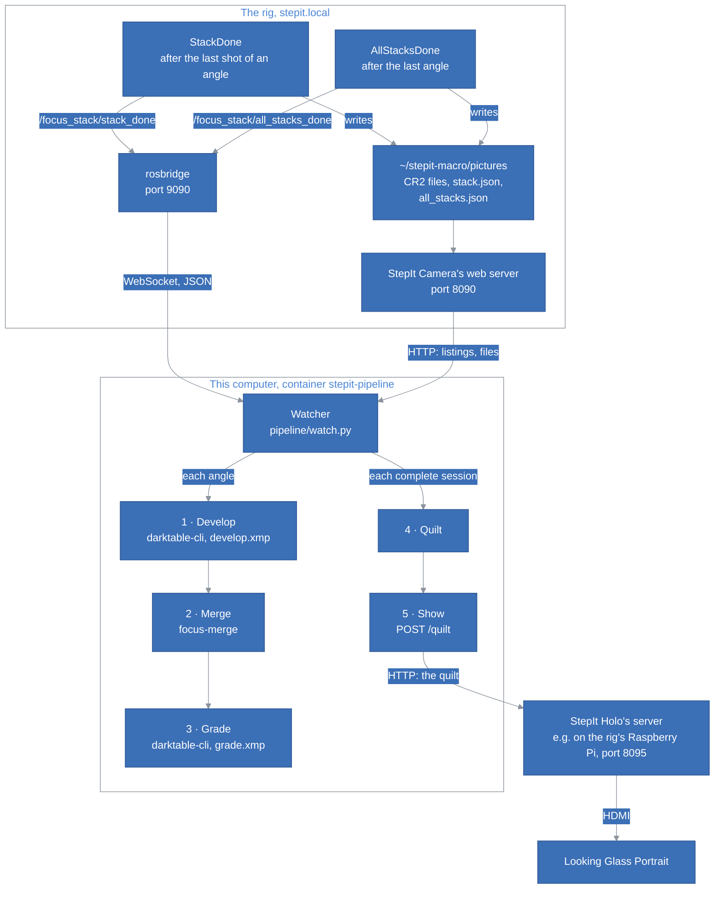
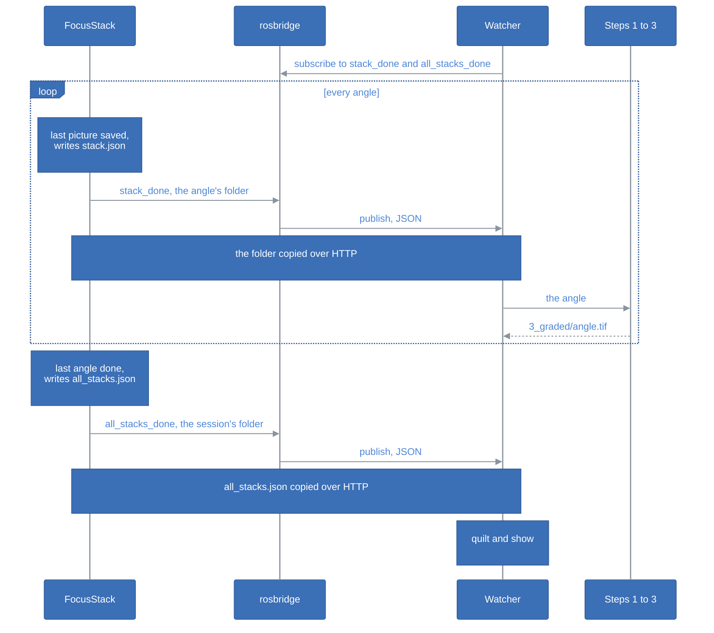

# StepIt Stacker Architecture

## Table of Contents <!-- omit in toc -->

- [Introduction](#introduction)
- [The Big Picture](#the-big-picture)
- [The Parts](#the-parts)
- [The Pipeline](#the-pipeline)
  - [1. Develop](#1-develop)
  - [2. Merge](#2-merge)
  - [3. Grade](#3-grade)
  - [4. Quilt](#4-quilt)
  - [5. Show](#5-show)
- [The Watcher](#the-watcher)
  - [Following the Rig](#following-the-rig)
  - [Catching Up](#catching-up)
  - [The Session While the Rig Shoots](#the-session-while-the-rig-shoots)
  - [A Complete Session](#a-complete-session)
- [The Containers](#the-containers)
- [Tests](#tests)
- [How to Extend StepIt Stacker](#how-to-extend-stepit-stacker)
- [Design Decisions and Trade-offs](#design-decisions-and-trade-offs)

## Introduction

This document explains how StepIt Stacker is built, what each part is responsible for, and where to start when we want to change something. It assumes we have read the [README](../README.md).

It follows one idea: **the rig only shoots, and says when an angle and a session are complete; everything else happens on this computer**. The rig, [StepIt Macro](https://github.com/kineticsystem/stepit-macro), knows nothing about StepIt Stacker: it publishes facts about its own pictures, and StepIt Stacker reads them, copies the pictures and processes them here.

## The Big Picture

StepIt Stacker is a Python package, `pipeline`, that chains other programs: darktable for the development and the grading, `focus-merge`, our C++ program, for the merge, and StepIt Holo, our module, for the display. It runs in one container, `stepit-pipeline`, which follows the rig.

What StepIt Stacker uses of the rig:

| Name | Type | What it is |
|---|---|---|
| `/focus_stack/stack_done` | `std_msgs/String` topic, latched | The folder of an angle whose pictures are all saved, relative to the rig's pictures folder, e.g. `2026-10-07_12-29-19/angle_01_0.0deg`. Published by `StackDone` in the objective `FocusStack`. |
| `/focus_stack/all_stacks_done` | `std_msgs/String` topic, latched | The folder of a session whose angles are all done, e.g. `2026-10-07_12-29-19`. Published by `AllStacksDone` in the objective `FocusStack`, after the last angle's `StackDone`. A session that stops halfway is never announced. |
| `ws://stepit.local:9090` | rosbridge WebSocket | The commander's rosbridge, which StepIt UI also uses. It relays the topics as JSON. |
| `stack.json` | file in the folder of a finished angle | The shots, the angle and the files of the folder. Written to a temporary file and renamed, so its presence says the angle is complete. |
| `all_stacks.json` | file in the folder of a finished session | The shots, the angles and, in `stacks`, the folders of the angles. Written the same way, so its presence says the session is complete. |
| `http://stepit.local:8090/pictures/` | HTTP, StepIt Camera's web server | The rig's pictures folder, which StepIt Stacker reads and never writes: `/pictures/<path>` a file, with `Range`; `/pictures/<folder>/` what a folder holds, as JSON, with each file's size, and `?recursive=1` everything below it. StepIt Camera describes it at `/docs`. |

## The Parts

| Path | Role |
|---|---|
| [`bin/pipeline.sh`](../bin/pipeline.sh) | Builds and starts the container `stepit-pipeline`, with the screen, for darktable's editor, and runs the commands in it. |
| [`pipeline/__main__.py`](../pipeline/__main__.py) | The commands: `watch`, `session`, `edit`, `grade`, `quilt`, `show`. |
| [`pipeline/watch.py`](../pipeline/watch.py) | The watcher: one angle or session at a time, as the rig announces them: each angle's steps 1 to 3, and each session's quilt. |
| [`pipeline/rig.py`](../pipeline/rig.py) | The rig: its topics through rosbridge, its pictures over HTTP. |
| [`pipeline/process.py`](../pipeline/process.py) | The steps chained, for an angle and for a session. |
| [`pipeline/darktable.py`](../pipeline/darktable.py) | Steps 1 and 3, with `darktable-cli`, and darktable's window for `edit`. |
| [`pipeline/merge.py`](../pipeline/merge.py) | Step 2: runs `focus-merge`. |
| [`pipeline/quilt.py`](../pipeline/quilt.py) | Step 4. |
| [`pipeline/display.py`](../pipeline/display.py) | Step 5: uploads the quilt to StepIt Holo's server. |
| [`pipeline/layout.py`](../pipeline/layout.py) | Where the files of a session are. |
| [`pipeline/config.py`](../pipeline/config.py) | Reads `config/pipeline.toml`. |
| [`src/`](../src) | `focus-merge`: `tiff_io` reads and writes the 16-bit TIFFs, `align` aligns the frames, `fuse` merges them, `main` chains them. |
| [`config/`](../config) | `pipeline.toml`, `develop.xmp`, `grade.xmp`. |
| [`tests/`](../tests) | `focus-merge` on a synthetic focus stack, and the quilt. |
| [`docker/`](../docker) | The image, and the development container. |

## The Pipeline

[`process.py`](../pipeline/process.py) runs steps 1 to 3 for each angle, and steps 4 and 5 for a session. Every step writes its result to a temporary name and moves it into place once whole, so a step cut short leaves no file behind, and the next run does it again.

### 1. Develop

`darktable-cli` develops every raw frame of the angle, in one run, into a 16-bit TIFF with the settings of [`config/develop.xmp`](../config/develop.xmp). The frames come out:

- **Linear.** No exposure, no tone curve, no sharpening, nothing but darktable's basic raw steps: the sensor's values, with nothing clipped. On a frame of the 5D Mark II the brightest pixel is at about a third of the 16-bit range.
- **In linear Rec.2020,** with the ICC profile embedded: a gamut wide enough that no colour is clipped before the grading.
- **With the hot pixels repaired,** by darktable's hot pixels module, on the raw data, before demosaicing, where a defect is still a single photosite.
- **With the white balance the camera recorded,** the same in every file of a session.
- **As the sensor sees them, landscape.** The camera's orientation is ignored. The 5D Mark II decides it with a tilt sensor, which cannot tell which way is up when the camera points down at the subject, as it does on the rig: on one session, an angle had 6 frames flagged landscape and 6 portrait, even with Auto rotate off. Frames turned by their own flags could not be aligned. `images.rotate` turns the merged image instead, the same way for every angle. On the rig it is 90: the stage's turn moves the subject up and down in the sensor's picture, by about 58 pixels between the first and the middle angle of a ±17° session against 10 sideways, and the Portrait shows its views from side to side. Without the turn, the head moving sideways sees the subject slide up and down, a moving picture rather than depth. Turned upright, a 3:2 picture also keeps more of itself in the Portrait's 3:4.

`develop.xmp` lists only what it changes: the hot pixels module on, the orientation off. darktable fills in its basic steps for each file, e.g. the white balance of that file. Three settings given on the command line complete it: 16-bit TIFF, the white balance the camera recorded ("legacy" chromatic adaptation), and no default exposure and tone curve (workflow "none").

**Every run gets a fresh darktable configuration**, a temporary folder, so the settings of the darktable used by hand never change what the pipeline does. An XMP file for `darktable-cli` must not hold comments: darktable cannot open it then.

The developed frames, about 100 MB each, are in a hidden temporary folder of the session, deleted once merged.

### 2. Merge

`focus-merge -o merged.tif frame1.tif ... --rotate <degrees>` merges the developed frames of an angle into one 16-bit TIFF, with the ICC profile of the frames. It reads the frames once, all at the same time, and keeps them in 16 bits, about 130 MB each for the 5D Mark II, until each is merged. For an angle of 10 frames on this PC's 10-core i9, the merge takes about 21 seconds, at about 6 cores on average: under a second to read, 15 to align, 6 to fuse. Reading the frames one at a time, twice, and aligning them one pair after the other took 44 seconds, at 2 cores.

**Alignment**, [`align.cc`](../src/align.cc). The rig repeats its positions exactly, yet the frames need aligning: on a linear rail the camera moves toward the subject, so each frame is magnified more than the one before, 0.3% to 1.5% per step on the sessions measured, and the light on the subject drops by 2 to 3% per step.

1. Each frame is matched to the one before with an affine transform, by OpenCV's ECC on the square root of its luminance, at half size, refined from a coarse size of at least 128 pixels to the full half size. The first pair is matched from no movement. The rail moves the same way at every step, so its transform is the starting guess of every other pair, and they are matched at the same time; from no movement, a pair takes many more iterations. A pair that does not converge is matched again from its neighbour's transform. More pairs at a time do not go faster than about 3: they compete for the memory's bandwidth, not for the cores.
2. The transforms are chained, so every frame is placed relative to the first.
3. The reference is the most magnified frame. It sees the smallest area, which every other frame covers, so the merged image has no empty borders. Every angle makes the same rail steps, so every angle gets the same size and framing.
4. Each frame gets a gain that brings its mean brightness to the reference's. Blur does not change the mean, so frames focused at different depths compare fairly.

A pair that cannot be matched stops the merge with `frame N cannot be aligned with frame N-1`, and the angle gets no image.

**Fusion**, [`fuse.cc`](../src/fuse.cc). Each frame, warped onto the reference, is split into a Laplacian pyramid: its detail at a series of scales, from the finest to the coarsest, and a small blurred residual. At each scale and each point, the merged pyramid keeps the detail of the frame that has the most there, measured on the luminance of the detail, made positive and smoothed over 5 × 5 pixels so that one noisy pixel does not decide alone. The residuals, the overall brightness, are averaged. Rebuilding the image from the merged pyramid blends the frames without visible seams. Everything is in floating point, so the 16 bits of the frames are kept. Splitting a frame into its pyramid is the slow part: 4 frames are warped and split at the same time, each holding about 450 MB, then added one at a time, in the order they were shot, so the result is the same as adding them one by one.

5 full-size frames of the 5D Mark II take about 17 seconds.

### 3. Grade

`darktable-cli` grades the merged image with the session's `grade.xmp`, or `config/grade.xmp` when the session has none, into a 16-bit TIFF in sRGB: the image of the sequence. darktable never overwrites a file, so it exports into a temporary folder, and the result replaces the graded image.

`./bin/pipeline.sh edit` makes a session's `grade.xmp` with darktable's window: it copies the current grading next to the merged image of the angle closest to 0°, as `<image>.xmp`, the sidecar darktable reads an image's edit from, and opens darktable on it, with a library in memory, so that darktable always reads the sidecar. darktable saves every change there. Once darktable is closed, the sidecar becomes the session's `grade.xmp`, and every angle is graded again.

### 4. Quilt

[`quilt.py`](../pipeline/quilt.py) makes the quilt for the Portrait from the graded images, in the order of the angles:

1. Each image is cropped at its centre to the aspect of a view, 3:4, and scaled down to a view, 420 × 560.
2. The views are retimed to the 48 of the quilt. A view between two angles is made from both: each is warped toward it along the dense optical flow between them, OpenCV's Farneback, and the two are blended. The first and last views are the first and last angles.
3. The views are placed from the bottom left to the top right, the leftmost first, as Looking Glass expects: view 0 is the bottom left, rows go up.
4. The quilt is saved as an 8-bit PNG named `<session>_qs8x6a0.75.png`, which tells its layout to Looking Glass's tools.

The leftmost view is the last angle. The stage turns the subject, and a subject turned one way looks as if the camera had moved the other way: with the first angle first, the depth on the Portrait was inside out. `quilt.reverse` puts the first angle first, for a stage that turns the other way.

### 5. Show

[StepIt Holo](https://github.com/kineticsystem/stepit-holo), a project of its own, shows a quilt on a Looking Glass Portrait. Its server runs on the computer the Portrait is plugged into, e.g. the rig's Raspberry Pi, in a container of its own: it reads the Portrait's calibration from the Portrait's own drive, turns the quilt into the image the Portrait's screen must show, and shows it straight on the screen, pixel for pixel. Its API is in its [API.md](https://github.com/kineticsystem/stepit-holo/blob/main/docs/API.md).

[`display.py`](../pipeline/display.py) uploads the quilt to `display.url`, `POST /quilt`, a multipart form with the PNG and its layout, `columns` and `rows`, and `reverse` false: the quilt is built in the order of its views already. Each quilt replaces the last on the Portrait, also after the server restarts. The server answers once the quilt is shown:

| Answer | What the step does |
|---|---|
| `200` | Logs where it is shown, e.g. `HDMI-A-1 of /dev/dri/card1, 1536 x 2048`. |
| `503` | Logs a warning, not an error: the server keeps the quilt, and shows it as soon as the Portrait is there. |
| Any other, or no answer | Fails, with the server's message, e.g. `cannot reach StepIt Holo at http://stepit.local:8095`. |

The form is built with the standard library, as the rest of the pipeline's HTTP, so that the image needs no HTTP client of its own.

## The Watcher

[`watch.py`](../pipeline/watch.py) is one class, `Watcher`, with three threads: the WebSocket's, which receives the rig's messages, a catch-up thread at each connection, and the worker, which processes one angle at a time from a queue.

### Following the Rig

The watcher opens the WebSocket and subscribes to `/focus_stack/stack_done` and `/focus_stack/all_stacks_done`; rosbridge then pushes every message as it is published. The rig never needs the address of this computer: to it, the watcher is one more subscriber, as the pages of StepIt UI are. The watcher pings every 20 seconds, which finds a rig that went away without closing the connection, and connects again every 10 seconds.

One worker takes the angles and the sessions from a queue, one at a time, in the order they come. For each angle, it copies the folder over HTTP into the mirror, under the session's `1_session`, and runs steps 1 to 3, unless the angle has a graded image newer than its frames and its `stack.json`. One angle that fails is logged with its error, and the worker goes on with the next.

The copy of an angle takes four steps, in [`rig.py`](../pipeline/rig.py), with Python's own `urllib`:

1. The listing of the angle's folder, `GET /pictures/<angle>/`, gives its files and their sizes.
2. Its `stack.json` says which files the angle is made of. An angle without one is not finished, and is skipped; one whose files are not all on the rig is refused, with an error.
3. Each of those files is downloaded, unless it is here already at the same size: into a hidden `.<name>.part` first, which a copy cut short continues with a `Range` request, and under its own name once whole, at its size.
4. `stack.json` is written last, so that an angle in the mirror is complete once its `stack.json` is there.

An angle of 10 frames, about 260 MB, takes about 2 seconds over a gigabit network. A folder name from the rig must match `[A-Za-z0-9_+.-]` and `/`, without `..`, and a file name `stack.json` lists must be a plain name, before either becomes a path here: a name from the rig must never lead out of the mirror.

### Catching Up

A message published while the watcher is not connected is lost: a topic is a live push, not a queue, and a latched topic only gives its last message. So at every connection, the watcher asks the rig for every `stack.json` and every `all_stacks.json`, with one request, `GET /pictures/?recursive=1`, which lists the whole pictures folder. It queues each angle that has no graded image here yet, then each session that has no quilt here yet. That is what makes the two files necessary: without them, the files could not tell a finished angle or session from one in progress. An angle or a session can be queued twice, by the catch-up and by the latched topic: the queue ignores one already in it.

The watcher also catches up every minute, `CATCH_UP_EVERY`, for a message lost while it was connected, e.g. one published before rosbridge had found a new publisher of the rig. A lost message then costs a minute, not the whole session until the next connection. A session found then was finished while the watcher ran, so it is shown, as its announcement would have been. What failed since the last connection, e.g. an angle that cannot be aligned, is left alone until the next connection, rather than merged again every minute. This catch-up logs only what it finds, and says once that the rig does not answer, and once that it answers again.

### The Session While the Rig Shoots

With `display.progress`, after each angle the rig announces, the worker builds the quilt of the session's angles graded so far and shows it: `preview_session()` of [`process.py`](../pipeline/process.py). The Portrait then shows the new subject as soon as its first angle is graded, flat, the same picture in all 48 views, then over the arc shot so far, its depth growing with each angle until the session's own quilt replaces it. Flat at first, rather than the session before until there are two angles: the new subject shows at once, and its framing can be checked while the rig shoots.

- **Not the session's quilt.** The preview is `4_quilt/<session>_preview_qs8x6a0.75.png`: the session's own quilt says that the session is done, and the catch-up would skip it. `finish_session()` removes the preview once the session's quilt is built, and a session that has its quilt gets no more previews.
- **Only the latest.** An angle queued by the catch-up shows none, and an angle with more angles of its session waiting in the queue shows none either: a backlog is processed first, and the last of its angles shows them all.
- **Never an error.** A preview that cannot be built or shown is a warning: the angle is done.

A preview takes about 7 seconds with 2 angles and 19 with 48 on this PC, mostly reading the 16-bit TIFFs and the optical flow between them, against minutes to develop and merge an angle. Each upload is a PNG of about 17 MB.

### A Complete Session

The rig says when a session is complete, on `/focus_stack/all_stacks_done`. For each session, the worker copies its `all_stacks.json` into the session's `1_session`, processes each angle it lists that has no graded image here yet, e.g. one whose announcement was lost with the connection, then builds the quilt of the graded images. An angle that failed is left out of the quilt, with a warning.

A session the rig announces is shown on the Portrait. A session found by the catch-up only gets its quilt, unless the rig announces it too: shown one after the other, the old sessions would end with the oldest on the Portrait rather than the latest. As the topic is latched, a watcher started after a session shows that session once it has checked its angles; and at every connection it shows the latest session again.

A session that stops halfway, e.g. at a shot whose picture did not come, gets no `all_stacks.json` and no quilt: its finished angles are processed, and `./bin/pipeline.sh session` builds its quilt by hand. So does a session shot before the rig had `AllStacksDone`.

## The Containers

One image, `stepit-stacker`, built from [`docker/Dockerfile`](../docker/Dockerfile) on Ubuntu 24.04, holds the build tools, darktable, OpenCV, libtiff, Python with OpenCV and `python3-websocket`, and `libnss-mdns`. The image runs in two ways:

| Container | Started by | What it mounts |
|---|---|---|
| `stepit-pipeline` | `./bin/pipeline.sh start` | The repo at `~/ws`, the home at its own path, the host's Avahi socket, and the X socket and its cookie, for darktable's editor. |
| `stepit-stacker`, for development | `./docker/dock.sh stepit-stacker start` | The repo at `~/ws`, the home at its own path. |

The repo is always at `~/ws`, so the CMake cache in `build`, which records its path, is valid in both. The home is mounted at its own path, so that a folder is given to a command by its host path.

`stepit-pipeline` uses the X server of one login, through its cookie, so it is started after logging in, and does not restart with the computer. Docker containers cannot resolve `.local` names, e.g. `stepit.local`, the rig's and StepIt Holo's: the container resolves them through the host's Avahi daemon, with `libnss-mdns` and the daemon's socket, `/run/avahi-daemon/socket`.

## Tests

`./bin/pipeline.sh test` runs the automated tests:

| Test | What it checks |
|---|---|
| [`test_focus_merge.py`](../tests/test_focus_merge.py) | `focus-merge` on a synthetic stack of 5 frames, each in focus at a different depth and magnified 1.5% more than the one before: the merged image must be at least twice as close to the sharp scene as the best frame. A frame that cannot be aligned must be reported by number. |
| [`test_quilt.py`](../tests/test_quilt.py) | The order of the views in the quilt, the crop to 3:4, and the retiming to 48 views. |
| [`test_process.py`](../tests/test_process.py) | The preview with real quilts and a stand-in for the display: none without an angle, one angle shown flat, the quilt of the angles done so far under its own name, removed by the session's quilt, none once the session is done, and a display that fails, which does not fail the angle. |
| [`test_display.py`](../tests/test_display.py) | The upload to StepIt Holo's server, against a stand-in for it: the form, with the quilt, its layout and `reverse` false, a quilt kept for later that is not an error, the server's message when it refuses the quilt, a server that cannot be reached, and no `display.url`. StepIt Holo's own tests run in its repo. |
| [`test_watch.py`](../tests/test_watch.py) | The watcher against a fake rig, a folder with the same layout, without steps 1 to 5: the rig's session is copied into `1_session`, each announced angle is processed, an announced session processes the angles whose announcement was missed and is shown, the catch-up builds the quilt of a finished session without showing it and leaves a session without `all_stacks.json` or with its quilt alone, a preview after each announced angle, none while angles of the session wait or when catching up or without `display.progress`, the catch-up every minute shows a session whose announcement was lost, leaves a failed angle alone until the next connection and says once that the rig does not answer, and a name that is not a session is ignored. |
| [`test_rig.py`](../tests/test_rig.py) | The copy from the rig over HTTP, against a stand-in for StepIt Camera's web server: the finished angles and sessions from one listing, an angle copied with its `stack.json` last, the files already here skipped, a copy cut short continued with `Range`, an angle not finished skipped, one whose files are not all on the rig refused, and a session's `all_stacks.json`. |

Checked by hand, to repeat after a change to each part:

| Part | How to check it |
|---|---|
| Develop | The developed frame is linear: its brightest pixels well below 65535, its ICC profile "Linear Rec2020 RGB". |
| Grade | `./bin/pipeline.sh edit` on a session: darktable opens with the current grading, and closing it grades every angle. |
| The watcher | Start it, shoot a FocusStack, follow `./bin/pipeline.sh logs`: each angle is queued as `announced by the rig`, processed, then the session, and the quilt is shown at the end. Stop it during a session and start it again: the missing angles are queued as `catching up`. The WebSocket has no automated test. |
| Show | `./bin/pipeline.sh show <quilt.png>` with StepIt Holo's server running and the Portrait attached to it, then look through the lens: one picture with depth, not a grid of views nor a blur. StepIt Holo's sample quilt, `wasp_qs8x6a0.75.jpg`, is the reference. |

The rig's side, `StackDone`, `AllStacksDone` and their files, is tested in StepIt Macro, against its fake camera.

## How to Extend StepIt Stacker

**Change how every frame is developed.** Open a CR2 in darktable, set the modules, and save the sidecar it writes, `<file>.CR2.xmp`, over `config/develop.xmp`, without comments. Keep the frames linear: no exposure, no tone curve, no sharpening, see [Develop](#1-develop).

**Add a step to each angle, e.g. a depth map.** Add it to `process_angle()` in [`process.py`](../pipeline/process.py), after the merge or the grading, and its file to [`layout.py`](../pipeline/layout.py), in a folder numbered after the one of the step before, e.g. `3_depth` between `2_merged` and the grading, which becomes `4_graded`.

**Show the session another way.** Replace `display.show()`, which `finish_session()` calls with the quilt. **Show it on another Portrait**: set `display.url` to its StepIt Holo's server.

**Use another Looking Glass.** Set its quilt in `[quilt]` of `config/pipeline.toml`: columns, rows and the size of a view.

## Design Decisions and Trade-offs

**darktable for the development and the grading.** The grading is made by hand in darktable's editor, and the same engine applies it without the window, from the XMP file the editor saves. darktable reads the 5D Mark II's CR2 files, repairs hot pixels on the raw data, and exports 16-bit TIFF in any colour space. The price is a configuration that must be given on every run, and XMP files tied to darktable's version: the editor and `darktable-cli` are the same darktable, the one of the image.

**focus-merge is our own.** focus-stack, the obvious library, aligns and merges in 8 bits only. `focus-merge` aligns with OpenCV's ECC and merges with a Laplacian pyramid in floating point, a few hundred lines. The price is a merge that is simpler than focus-stack's wavelet merge: fine detail that overlaps, e.g. hairs in front of each other, may come out less clean.

**The frames are merged linear, and graded once merged.** Sharpening or local contrast before the merge would boost the noise in the blurred parts of each frame and draw halos along out-of-focus edges, which the merge takes for detail. Grading the merged image is also quicker, and seen on the image as it will be: changing the grading never needs a new merge.

**16-bit TIFF between the steps, not DNG or float.** The 5D Mark II records 14 bits, which 16 hold. Every tool reads TIFF with an ICC profile. The white balance and the exposure are set in the camera and the same in every file of a session, so a DNG's raw white balance would rarely be needed.

**The quilt's views are made between the angles.** A session has fewer angles than the 48 views. Shooting 48 angles is the clean way; optical flow fills the gap at the price of ghosts where it fails, e.g. thin legs crossing.

**StepIt Holo for the display, not Looking Glass's software.** Looking Glass Bridge 2.6.3, with LKG-Toolkit to play the quilt, showed every quilt flat on this PC, as a grid of views, in the container and installed on Ubuntu alike, whatever the scaling, the GPU driver or the window's position, and it is built for x86 only. StepIt Holo does the interleaving itself, from published math and the Portrait's own calibration, and is open source. It is a project of its own, so that anyone with a Portrait can use it.

**The quilt uploaded to a server, not shown by this computer.** The Portrait hangs off a computer of its own, e.g. the rig's Raspberry Pi: no desktop scaling to share with a 4K monitor, no window that GNOME puts on the wrong monitor, and a pipeline that needs no desktop to show. StepIt Holo's server keeps the last quilt and shows it again after a restart, so the Portrait shows the latest session even when this computer is off. The price: one more server to run, and an upload of a few MB per session.

**The rig announces the angles; the watcher does not watch the files.** A folder that stops growing may only be waiting for its next shot, and its last file may still be being written. Only the rig knows when an angle is complete, so it says it, as a ROS topic and as `stack.json`. The rig does not know who listens.

**rosbridge, not ROS on this computer.** The rig's DDS is set to its own computer, loopback only. Opening it to the network would change the whole rig, and need ROS here. rosbridge is already there for StepIt UI, and a WebSocket client is a few lines of Python.

**The camera's web server, not rsync over ssh.** The rig's pictures stay in its pictures folder, which StepIt Camera's web server already serves, for StepIt UI, on port 8090. Its listing of a folder, with each file's size, does what rsync and `find` over ssh did: the catch-up finds the finished angles and sessions in one request, a file already here at its size is skipped, and a copy cut short continues with `Range`. No key logs in to the rig, the stacker only reads, and the container no longer needs `~/.ssh`, nor rsync. The price: the web server has no password, and serves the pictures to anyone on the network, as it does for StepIt UI.

**Python for the pipeline, C++ for the merge.** The pipeline is glue: a WebSocket, a queue, and other programs. The merge is where the time goes, and is C++ to work with OpenCV directly.

**One angle at a time.** darktable and the merge use every core, so processing two angles at once would be no faster. The rig takes longer to shoot an angle than this computer to process it, so the queue stays short.

**The images stay on this computer.** The rig is a source of pictures, and nothing goes back to it: the mirror and the images live in this repo's `pictures` folder, which git ignores.
