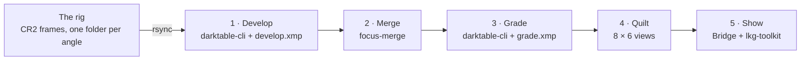

# The 3D Pipeline

A prototype. It turns each session of the rig, a focus stack at every angle of the stage, into a sequence of graded 16-bit images, one per angle, and shows them as a 3D image on the Looking Glass Portrait, without anyone at the computer.

## Table of Contents <!-- omit in toc -->

- [What It Does](#what-it-does)
- [What You Provide](#what-you-provide)
- [What You Configure](#what-you-configure)
- [Build and Run](#build-and-run)
- [Grade a Session by Hand](#grade-a-session-by-hand)
- [The Files of a Session](#the-files-of-a-session)
- [The Code](#the-code)
- [Not Tested Yet](#not-tested-yet)

## What It Does



Steps 1 to 3 run for each angle as soon as the rig has shot it. Steps 4 and 5 run once the rig has shot the whole session.

1. **Develop.** darktable turns every raw frame of the angle into a 16-bit TIFF, linear, in Rec.2020, with the settings of `config/develop.xmp`. It repairs the hot pixels and ignores the orientation the camera records. It adds no exposure, tone curve or sharpening, so nothing is clipped and the merge sees the frames as the sensor did.
2. **Merge.** `focus-merge` aligns the frames and merges them into one 16-bit image that is sharp everywhere. Every frame is aligned to the most magnified one, which every other frame covers, so the merged image has no empty borders and every angle gets the same size and framing. The merge keeps, at each point and each scale of detail, the frame with the most detail there.
3. **Grade.** darktable grades the merged image with `grade.xmp` into a 16-bit sRGB TIFF: the image of the sequence.
4. **Quilt.** Every graded image is cropped at its centre to 3:4 and scaled to 420 × 560. Optical flow then makes the 48 views the Portrait shows from the angles of the session, and the views are tiled into an 8 × 6 quilt.
5. **Show.** Looking Glass Bridge, which drives the Portrait, plays the quilt in a loop until the next session replaces it.

On this computer an angle of 3 frames takes about 20 seconds, and the quilt about 10 seconds.

## What You Provide

| What | Where | If you do not |
|---|---|---|
| The rig, reachable by ssh with this computer's key, as for the [watcher](../README.md#merge-the-stacks-as-the-rig-shoots-them) | `config/pipeline.toml` | Run sessions already on disk with `./bin/pipeline.sh session <folder>`. |
| The Looking Glass Portrait, on HDMI and USB-C, plugged in before `./bin/pipeline.sh start` | | The quilt is saved but not shown. |
| A grading, `grade.xmp` | The session's folder, made with `./bin/pipeline.sh edit`, see [Grade a Session by Hand](#grade-a-session-by-hand) | `config/grade.xmp`, darktable's default look for a raw file: +0.7 EV and filmic. |
| A development, `develop.xmp` | `config/develop.xmp` | It is in the repo. |

A session on disk is a folder with one folder of raw frames per angle, named so that they sort in the order of the angles, as the rig names them:

```
2026-10-07_12-29-19/
├── angle_01_-8.0deg/IMG_5460.CR2 ...
├── angle_02_-7.5deg/IMG_5465.CR2 ...
...
```

## What You Configure

`config/pipeline.toml`:

| Setting | Default | What it is |
|---|---|---|
| `rig.host`, `rig.user` | `stepit.local`, `robot` | The rig, for ssh and rsync. |
| `rig.port` | `9090` | The commander's rosbridge, where the rig announces each finished angle. |
| `rig.pictures` | `stepit-macro/pictures` | The rig's pictures folder, relative to the user's home on the rig. |
| `pictures.mirror` | `pictures` | Where the rig's pictures are copied, and the images of each session are saved: relative to the repo, or absolute. Git ignores `pictures`. |
| `images.rotate` | `0` | Turns every merged image clockwise by 0, 90, 180 or 270 degrees. 0 keeps it as the sensor sees it, landscape. |
| `quilt.reverse` | `false` | Set it to `true` if the depth on the Portrait looks inside out. |

The other settings of `[quilt]` are those of the Portrait.

On the Ubuntu desktop, set the Portrait as Looking Glass asks: an extended display ("Join Displays"), in portrait orientation, at 100% scaling.

## Build and Run

Everything runs in the Docker image of the repo, which now also holds darktable, Looking Glass Bridge and LKG-Toolkit. Start the pipeline after logging in to the desktop, as it draws on the screen of that login:

```bash
./bin/pipeline.sh start
```

The first start builds the image and the programs, which takes a few minutes. Then the container `stepit-pipeline` runs the watcher. Each time the rig finishes an angle, the watcher copies it, then develops, merges and grades it. When the rig has shot the whole session, the watcher builds the quilt and shows it on the Portrait. So: place the bug, start the FocusStack in StepIt UI, and come back when it is done.

```bash
./bin/pipeline.sh logs                    # follow what it does
./bin/pipeline.sh session <session>       # process a session already on disk, then show it
./bin/pipeline.sh show <quilt.png>        # show a quilt again
./bin/pipeline.sh test                    # run the tests
./bin/pipeline.sh stop
```

A session already processed is skipped angle by angle, so `session` also finishes one that was cut short.

## Grade a Session by Hand

```bash
./bin/pipeline.sh edit <session>
```

1. darktable opens the merged image of the angle closest to 0°, starting from the session's current grading.
2. Grade it: exposure, tone equalizer for the shadows and highlights, filmic or sigmoid for the contrast, color balance rgb for the saturation, diffuse or sharpen for the sharpness. Keep to edits of the whole image: a mask or a spot repair stays at the same place in every image while the subject turns.
3. Close darktable. The edit is saved as `grade.xmp` in the session's folder, every angle is graded with it, and the new quilt is shown.

To start every later session from this grading, copy that `grade.xmp` over `config/grade.xmp`.

## The Files of a Session

```
pictures/2026-10-07_12-29-19/
├── angle_01_-8.0deg/          the raw frames, copied from the rig, and stack.json
├── ...
├── merged/angle_01_-8.0deg.tif     16-bit, linear Rec.2020: the master, for grading again
├── graded/angle_01_-8.0deg.tif     16-bit, sRGB: the sequence
├── quilt/2026-10-07_12-29-19_qs8x6a0.75.png
└── grade.xmp                  the session's own grading, after ./bin/pipeline.sh edit
```

The developed frames, about 100 MB each, are deleted once merged.

## The Code

| Path | Role |
|---|---|
| [`bin/pipeline.sh`](../bin/pipeline.sh) | Starts the container `stepit-pipeline`, with the screen, the GPU and the USB of the Looking Glass, and runs the commands in it. |
| [`pipeline/__main__.py`](__main__.py) | The commands: `watch`, `session`, `edit`, `grade`, `quilt`, `show`. |
| [`pipeline/watch.py`](watch.py) | The watcher: one angle at a time, as the rig announces them; the quilt once the session is complete. |
| [`pipeline/rig.py`](rig.py) | The rig: its topics through rosbridge, its pictures through ssh and rsync. |
| [`pipeline/process.py`](process.py) | The steps chained, for an angle and for a session. |
| [`pipeline/darktable.py`](darktable.py) | Steps 1 and 3, and darktable's window for `edit`. |
| [`pipeline/merge.py`](merge.py) | Step 2: runs `focus-merge`. |
| [`pipeline/quilt.py`](quilt.py) | Step 4. |
| [`pipeline/display.py`](display.py) | Step 5. |
| [`pipeline/layout.py`](layout.py) | Where the files of a session are. |
| [`pipeline/config.py`](config.py) | Reads `config/pipeline.toml`. |
| [`src/merge/`](../src/merge) | `focus-merge`, in C++: `tiff_io` reads and writes the 16-bit TIFFs, `align` aligns the frames, `fuse` merges them, `main` chains them. |
| [`config/`](../config) | `pipeline.toml`, `develop.xmp`, `grade.xmp`. |
| [`tests/`](../tests) | `focus-merge` on a synthetic focus stack, and the layout and retiming of the quilt. |

**How a session is known to be complete.** The rig publishes `[pictures taken, pictures in total]` for the whole FocusStack on `/focus_stack/progress`. The watcher builds the quilt after an angle when the two are equal, the angle belongs to the session the rig announced last, and no other angle of it waits.

**focus-merge is ours, not focus-stack.** focus-stack aligns and merges in 8 bits only. `focus-merge` aligns each frame to its neighbour with OpenCV's ECC, refined from a coarse size to half the full size. It then merges with a Laplacian pyramid in floating point, adding one frame at a time, so its memory stays that of two pyramids whatever the number of frames. A frame that cannot be aligned stops the merge of its angle with a message, and the other angles go on. The old `stack` command and its watcher, `bin/watcher.sh`, are unchanged; run only one of the two watchers.

**The views between the angles.** A session has fewer angles than the quilt's 48 views. A view between two angles is made from both, each warped toward it along the optical flow between them, as the Optical Flow Retimer of ComfyUI-LenticularPack does. Where the flow fails, e.g. thin legs crossing, a made view can show ghosts.

**Looking Glass's software.** Bridge 2.6.3 and LKG-Toolkit are not open source: they come under Looking Glass Factory's terms and the LKG-Toolkit licence agreement. They are used for personal, non-commercial use with the Portrait, which is why this repo is private, and neither is copied into it: the Dockerfile downloads them when the image is built. It runs Bridge's own installer, answering no to its analytics, and builds LKG-Toolkit unmodified, as its licence requires, then runs it on the .NET 8 runtime. `lkg-toolkit play` waits for a key press, so `display.py` runs it on a pseudo-terminal of its own, in the background.

## Not Tested Yet

Tested here: the whole pipeline on a session made of copies of one 5D Mark II raw file, `focus-merge` on synthetic stacks, darktable's window, and Bridge taking a quilt, with no Portrait attached. Still to check:

1. **Real stacks.** The alignment on the rig's frames, and the time of an angle of 5 or more frames.
2. **The Portrait.** That Bridge finds it from the container and draws on it. Bridge may need the Portrait's HID device, `/dev/hidraw*`, which only root can open by default: if `./bin/pipeline.sh logs` shows `Bridge lists no Looking Glass display`, a udev rule on the host must give it to the user, made from the Portrait's USB ids in `lsusb`.
3. **The depth.** The order of the views, with `quilt.reverse` if the depth looks inside out.
4. **`images.rotate`** for the rig's camera.
5. **The flicker** between angles, [TODO item 3](../TODO.md#3-the-light-flickers-between-angles), which the pipeline does not correct.
